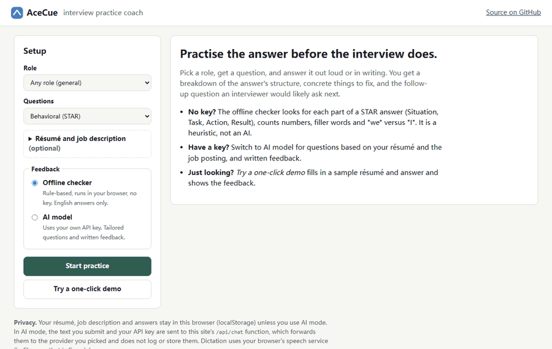

# AceCue

A browser-based interview practice coach: answer a question for your target role by typing or speaking, and get STAR-structured feedback plus the follow-up an interviewer would likely ask.



**Try it:** https://acecue.vercel.app (press *Try a one-click demo*, no key needed) · [中文说明](README.zh-CN.md)

## Why I built it

I'm applying for internships, and when I rehearsed answers in my head I kept skipping the same parts: no clear goal, a lot of "we", and an ending with no result. I wanted something that asks me a question, lets me answer out loud, and then points at the part I left out.

An earlier version of this repo was a "live interview copilot" that listened to a meeting and suggested answers in real time. I removed it. Using it in a real interview is cheating, and it is not something I want my name on. What is left is the part that helps before the interview: practice.

## What it does

1. Pick a role (general, software, data, product, hardware/chip design) and a question type (behavioral, technical or mixed).
2. Get a question from the built-in bank, or one written by a model from your résumé and the job posting.
3. Answer in the text box or press **Dictate** and say it. A timer and word count show how long the spoken answer would be.
4. Get feedback: each STAR part (Situation, Task, Action, Result) marked missing / weak / strong with a note, a score out of 10, things to fix, and a likely follow-up question you can answer next. Technical questions use a different rubric: approach, reasoning, example, limits.
5. Download the session as Markdown to keep notes.

There are two feedback engines:

| | Offline checker | AI model |
| --- | --- | --- |
| How | Rules in [`star-check.js`](public/js/star-check.js): cue phrases for each STAR part, word count, filler words, hedging, "we" vs "I", numbers | Your own key; the model writes questions from your résumé and the job posting and returns feedback as JSON, shown in the same layout |
| Needs | Nothing. Runs in the browser | A key for OpenAI, Anthropic, Gemini, DeepSeek, Mistral or OpenRouter |
| Limits | English only. It checks structure, not whether the story is good, and it can be gamed | Costs API credit; quality depends on the model |

The one-click demo fills in a made-up student résumé, a made-up job posting and a sample answer, then runs the offline checker on it.

## Run it locally

Node 20 or newer. There are no dependencies to install.

```bash
git clone https://github.com/appleweiping/acecue.git
cd acecue
npm run dev      # http://localhost:3000
npm test         # unit tests for the checker, prompts and the API proxy
```

To click through AI mode without a key, start the dev server with canned replies: `MOCK_UPSTREAM=1 npm run dev` (PowerShell: `$env:MOCK_UPSTREAM=1; npm run dev`) and type any text as the key. The replies come from [`scripts/mock-upstream.mjs`](scripts/mock-upstream.mjs) and are marked "(mock)".

To deploy your own copy, import the repo on Vercel. No build step and no environment variables are needed.

## How keys are handled

- In AI mode the browser sends your key in an `X-User-Key` header to this site's `/api/chat` edge function, which calls the provider once and streams the reply back. The function does not log or store the key. The key stays in `sessionStorage` (cleared when the tab closes) unless you tick *Remember the key*, which puts it in `localStorage`.
- `/api/chat` only answers pages served from its own host (it checks the `Origin` header), so another website cannot use a deployment as a free relay from its visitors' browsers.
- The server ignores any provider keys in its environment unless `ALLOW_OPERATOR_KEYS=1` is set, and then it rate-limits per client IP. See [`.env.example`](.env.example).
- The offline checker and the question bank never touch the network. Dictation uses the browser's speech recognition; in Chrome that audio goes to Google.

The provider code (`api/`, `public/js/stream-client.js`, the dev server and its tests) is shared with my other project [ai-mirror](https://github.com/appleweiping/ai-mirror). Both repos keep identical copies; `npm run check:shared` compares them with the GitHub copy of the other repo.

## Why not just paste the answer into a chatbot?

You can, and for one answer that works fine. AceCue saves writing the prompt each time, applies the same rubric to every answer so scores in one session are comparable, shows spoken length while you answer, works offline with no account, and keeps the session as a Markdown file. Commercial interview tools do more (video, speech analysis) but need an account and usually a subscription.

## Project layout

```
public/            static page, no framework, no build step
  js/star-check.js   offline STAR checker
  js/questions.js    question bank per role
  js/coach.js        prompts for AI mode, JSON feedback parsing, Markdown export
  js/speech.js       Web Speech dictation
  js/main.js         page logic
api/               Vercel edge functions: /api/chat (streaming proxy), /api/models
scripts/           local dev server, mock upstream, shared-file check
test/              node:test unit tests
```

## License

MIT, see [LICENSE](LICENSE).
